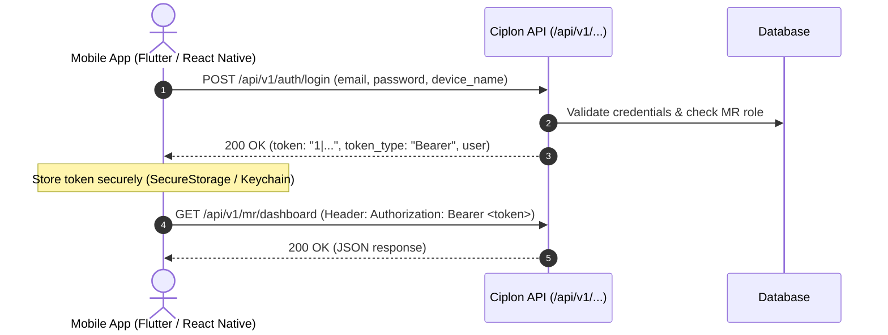

# Ciplon Pharma API Documentation

> **Version:** 1.0.0  
> **Base URL:** `/api/v1/mr`  
> **Architecture:** RESTful over HTTP/HTTPS  
> **Data Format:** JSON (`application/json`)  
> **Authentication:** Cookie / Web Session with CSRF & Sanctum protection  
> **Role Requirements:** `mr`, `admin`, `super_admin`, or `manager`

---

## Table of Contents

1. [Overview & Standards](#1-overview--standards)
2. [Authentication & Security](#2-authentication--security)
   - [Mobile App API Login (No CSRF / Bearer Token)](#21-mobile-app-api-login-no-csrf--bearer-token)
   - [Mobile App API Identity & Logout](#22-mobile-app-api-identity--logout)
   - [Web Browser Session Login (Cookie / CSRF)](#23-web-browser-session-login-cookie--csrf)
   - [Password Reset via 6-Digit OTP](#24-password-reset-via-6-digit-otp)
3. [Standard Response & Error Conventions](#3-standard-response--error-conventions)
4. [MR Dashboard API](#4-mr-dashboard-api)
   - [Get Comprehensive Dashboard Metrics & Map](#41-get-mr-dashboard)
5. [MR Doctor Directory API](#5-mr-doctor-directory-api)
   - [List Doctors with Metadata](#51-list-doctors)
   - [Create New Doctor](#52-create-doctor)
   - [Get Single Doctor Profile](#53-get-doctor-by-id)
   - [Update Doctor Profile](#54-update-doctor)
   - [Remove Doctor from Directory](#55-delete-doctor)
6. [MR Visits & Call Logging API](#6-mr-visits--call-logging-api)
   - [List Visits with Metrics](#61-list-visits)
   - [Schedule or Log Visit](#62-create-or-log-visit)
   - [Get Single Visit Details](#63-get-visit-by-id)
   - [Update Visit Record](#64-update-visit)
   - [Delete Visit Record](#65-delete-visit)
7. [MR Products & Digital Detailing API](#7-mr-products--digital-detailing-api)
   - [List Detailing Products](#71-list-products)
   - [Get Product Detailing Guide & Slide Deck](#72-get-product-detailing-deck)
8. [MR Field Tracking & Geolocation API](#8-mr-field-tracking--geolocation-api)
   - [Synchronize Live GPS Location](#81-update-live-location)
   - [Get Doctor Route & Mapbox Config](#82-get-doctor-route)
9. [Auxiliary Endpoints](#9-auxiliary-endpoints)
   - [In-App Notifications](#91-notifications)
   - [Public Commercial Enquiries](#92-public-commercial-enquiries)
10. [Domain Enums & Data Dictionary](#10-domain-enums--data-dictionary)

---

## 1. Overview & Standards

The **Ciplon Field Operations API** exposes a dedicated suite of high-performance endpoints powering the Medical Representative (MR) application, field force automation, digital detailing, and geolocation telemetry.

### Standard Request Headers
For all API interactions, clients must transmit standard JSON and CSRF headers:

| Header | Value | Description |
|---|---|---|
| `Accept` | `application/json` | Guarantees JSON response payload (prevents redirect to login on 401). |
| `Content-Type` | `application/json` | Indicates JSON formatted body for `POST`, `PUT`, `PATCH`. |
| `X-XSRF-TOKEN` | `<decrypted_token>` | Read from `XSRF-TOKEN` cookie for CSRF validation. |
| `X-Requested-With`| `XMLHttpRequest` | Standard AJAX marker for Laravel. |

---

## 2. Authentication & Security

The API supports two authentication flows:
1. **Mobile App Clients (Flutter, React Native, iOS, Android):** Stateless Token Authentication using Laravel Sanctum Bearer tokens. **No CSRF token or cookie is required.**
2. **Web Browser SPA / Inertia:** Stateful Cookie session authentication.



### 2.1 Mobile App API Login (No CSRF / Bearer Token)
Authenticates a Medical Representative from a mobile application and issues a personal access Bearer token.

* **Endpoints:**
  - `POST /api/v1/auth/login` (Standard)
  - `POST /api/v1/mr/login` (Alias)
  - `POST /api/v1/login` (Alias)
* **Auth Required:** None (Public, **CSRF verification exempt**)
* **Headers:**
  - `Accept: application/json`
  - `Content-Type: application/json`

#### Request Payload
| Field | Type | Required | Description |
|---|---|---|---|
| `email` | string (email) | Yes | Account email address (e.g. `mr@ciplon.com`). |
| `password` | string | Yes | Account password. |
| `device_name` | string | No | Client device identifier (e.g. `iPhone 15 Pro`, `Pixel 8`, `Ciplon Android`). Defaults to `'Mobile App'`. |

#### Example Request (cURL)
```bash
curl -X POST "https://your-domain.test/api/v1/auth/login" \
  -H "Accept: application/json" \
  -H "Content-Type: application/json" \
  -d '{
    "email": "rep@ciplon.com",
    "password": "SecretPassword123!",
    "device_name": "Flutter Android"
  }'
```

#### Success Response (`200 OK`)
```json
{
  "success": true,
  "message": "Login successful.",
  "token": "1|qX8b7sA9Z1K2L3M4N5O6P7Q8R9S0T1U2V3W4X5Y6",
  "token_type": "Bearer",
  "user": {
    "id": 5,
    "name": "Rupesh MR",
    "email": "rep@ciplon.com",
    "role": "mr",
    "roles": ["mr"]
  }
}
```

#### Error Responses
- **401 Unauthorized (Invalid Credentials):**
  ```json
  {
    "success": false,
    "message": "The provided credentials do not match our records.",
    "errors": {
      "email": ["The provided credentials do not match our records."]
    }
  }
  ```
- **403 Forbidden (Non-MR User Role):**
  ```json
  {
    "success": false,
    "message": "Access denied. Medical Representative or authorized staff privileges required."
  }
  ```

---

### 2.2 Mobile App API Identity & Logout

#### Get Current Profile
* **Endpoint:** `GET /api/v1/auth/me` (or `GET /api/v1/mr/me`)
* **Headers:** `Authorization: Bearer <token>`, `Accept: application/json`
* **Success Response (`200 OK`):**
  ```json
  {
    "success": true,
    "user": {
      "id": 5,
      "name": "Rupesh MR",
      "email": "rep@ciplon.com",
      "role": "mr",
      "roles": ["mr"]
    }
  }
  ```

#### Revoke Token (Logout)
* **Endpoint:** `POST /api/v1/auth/logout` (or `POST /api/v1/mr/logout`)
* **Headers:** `Authorization: Bearer <token>`, `Accept: application/json`
* **Optional Request Body:**
  ```json
  {
    "all_devices": true
  }
  ```
* **Success Response (`200 OK`):**
  ```json
  {
    "success": true,
    "message": "Successfully logged out."
  }
  ```

---

### 2.3 Web Browser Session Login (Cookie / CSRF)
For web browser SPAs and administrative portals using session cookies.

* **CSRF Cookie Handshake:** `GET /sanctum/csrf-cookie`
* **Web Login:** `POST /login`
* **Web Logout:** `POST /logout`

---

### 2.4 Password Reset via 6-Digit OTP

#### 1. Request OTP Code
* **Endpoint:** `POST /forgot-password/send-otp`
* **Rate Limit:** 6 requests / minute
* **Request Body:**
  ```json
  {
    "email": "doctor.rep@ciplon.com"
  }
  ```
* **Success Response (`200 OK`):**
  ```json
  {
    "success": true,
    "message": "A 6-digit verification code has been dispatched to your email address."
  }
  ```

#### 2. Verify OTP Code
* **Endpoint:** `POST /forgot-password/verify-otp`
* **Rate Limit:** 10 requests / minute
* **Request Body:**
  ```json
  {
    "email": "doctor.rep@ciplon.com",
    "otp": "481920"
  }
  ```
* **Success Response (`200 OK`):**
  ```json
  {
    "success": true,
    "message": "Verification code confirmed. Please set your new password."
  }
  ```

#### 3. Submit New Password
* **Endpoint:** `POST /forgot-password/reset-password`
* **Rate Limit:** 6 requests / minute
* **Request Body:**
  ```json
  {
    "email": "doctor.rep@ciplon.com",
    "otp": "481920",
    "password": "NewSecurePassword456#",
    "password_confirmation": "NewSecurePassword456#"
  }
  ```
* **Success Response (`200 OK`):**
  ```json
  {
    "success": true,
    "message": "Password reset successfully! You can now log in with your new credentials."
  }
  ```

---

## 3. Standard Response & Error Conventions

### Standard Success Envelope
```json
{
  "success": true,
  "message": "Operation completed successfully.",
  "data": { ... },
  "meta": { ... }
}
```

### Standard Validation Error Envelope (`422 Unprocessable Content`)
```json
{
  "message": "The given data was invalid.",
  "errors": {
    "phone": [
      "The phone field is required."
    ],
    "tier": [
      "The selected tier is invalid."
    ]
  }
}
```

### Standard Status Codes
| HTTP Code | Meaning | Context |
|---|---|---|
| `200 OK` | Request Succeeded | Read and update queries succeed. |
| `201 Created` | Resource Created | Entity successfully persisted in database. |
| `401 Unauthorized` | Unauthenticated | Missing or expired session cookie. |
| `403 Forbidden` | Access Denied | Authenticated user lacks `mr` role or owns neither the record. |
| `404 Not Found` | Resource Missing | Doctor or Visit ID does not exist under authenticated MR. |
| `422 Unprocessable` | Validation Failure | Payload failed data structure validation rules. |
| `500 Server Error` | Internal Exception | Unhandled server error. |

---

## 4. MR Dashboard API

### 4.1 Get MR Dashboard
Retrieves performance targets, doctor coverage metrics, today's schedule, follow-up alerts, recent activities, Mapbox token, and geographic stops for the authenticated MR.

* **Route:** `GET /api/v1/mr/dashboard`
* **Middleware:** `['web', 'auth', 'mr']`

#### Query Parameters
None. Context is derived from the authenticated session user (`$request->user()->id`).

#### Example Request
```bash
curl -X GET "https://your-domain.test/api/v1/mr/dashboard" \
  -b cookies.txt \
  -H "Accept: application/json"
```

#### Example Response (`200 OK`)
```json
{
  "success": true,
  "data": {
    "mapbox": {
      "token": "pk.eyJ1IjoiY2lwbG9uIiwiYSI6ImNt...",
      "style": "mapbox://styles/mapbox/streets-v12",
      "default_lat": 8.1833,
      "default_lng": 77.4119,
      "default_zoom": 13
    },
    "doctor_stops": {
      "visited": [
        {
          "id": 14,
          "name": "Dr. Arvind Swaminathan",
          "specialization": "Cardiology",
          "clinic_hospital": "Apollo Speciality Clinic",
          "address": "42 Cross Cut Road, Gandhipuram",
          "lat": 8.1852,
          "lng": 77.4145,
          "status": "visited",
          "time": "10:00 AM"
        }
      ],
      "pending": [
        {
          "id": 22,
          "name": "Dr. Kavitha Raman",
          "specialization": "Pediatrics",
          "clinic_hospital": "Child Care Hospital",
          "address": "15 North Veli Street",
          "lat": 8.192,
          "lng": 77.4201,
          "status": "pending",
          "time": "11:00 AM"
        }
      ],
      "all": [ ... ],
      "route_coordinates": [
        [77.4119, 8.1833],
        [77.4145, 8.1852],
        [77.4201, 8.192]
      ],
      "mr_live_location": {
        "lat": 8.1833,
        "lng": 77.4119,
        "user_name": "Rupesh MR",
        "last_synced": "2 minutes ago"
      },
      "visited_count": 1,
      "pending_count": 1
    },
    "summary": {
      "today_visits": 6,
      "completed_visits": 1,
      "pending_visits": 5,
      "follow_ups_due": 3
    },
    "performance": {
      "visits": {
        "completed": 24,
        "target": 60
      },
      "doctors": {
        "covered": 18,
        "target": 25
      },
      "product_promotions": {
        "completed": 48,
        "target": 120
      },
      "achievement": 40
    },
    "today_visits": [
      {
        "id": 101,
        "doctor": "Dr. Arvind Swaminathan",
        "hospital": "Apollo Speciality Clinic",
        "time": "10:00 AM",
        "status": "Completed"
      }
    ],
    "upcoming_followups": [
      {
        "id": 89,
        "doctor": "Dr. Mohan Kumar",
        "purpose": "Sample feedback for CIP-D3",
        "date": "Nov 04, 2026",
        "status": "Pending"
      }
    ],
    "recent_activities": [
      {
        "id": 101,
        "description": "Completed call with Dr. Arvind Swaminathan",
        "time": "25 minutes ago"
      }
    ]
  }
}
```

---

## 5. MR Doctor Directory API

### 5.1 List Doctors
Lists doctors mapped strictly to the logged-in representative, featuring multi-criteria filtering, sorting, and aggregate tier statistics.

* **Route:** `GET /api/v1/mr/doctors`
* **Middleware:** `['web', 'auth', 'mr']`

#### Query Parameters
| Parameter | Type | Default | Description |
|---|---|---|---|
| `search` | string | `null` | Searches `name`, `clinic_hospital_name`, `specialization`, `territory`, or `phone`. |
| `specialization` | string | `all` | Filter by medical specialty (e.g. `Cardiology`, `Pediatrics`, `Diabetology`). |
| `tier` | string | `all` | Filter by classification: `core`, `class_a`, `class_b`, `class_c`. |
| `territory` | string | `all` | Filter by geographical territory name. |
| `status` | string | `all` | Filter by status: `active`, `inactive`. |
| `sort_by` | string | `name` | Allowed sort fields: `name`, `specialization`, `tier`, `target_frequency_per_month`, `created_at`. |
| `sort_order` | string | `asc` | `asc` or `desc`. |

#### Example Request
```bash
curl -X GET "https://your-domain.test/api/v1/mr/doctors?tier=core&sort_by=name&sort_order=asc" \
  -b cookies.txt \
  -H "Accept: application/json"
```

#### Example Response (`200 OK`)
```json
{
  "success": true,
  "data": [
    {
      "id": 14,
      "user_id": 3,
      "name": "Dr. Arvind Swaminathan",
      "qualification": "MD, DM (Cardio)",
      "specialization": "Cardiology",
      "clinic_hospital_name": "Apollo Speciality Clinic",
      "address": "42 Cross Cut Road, Gandhipuram",
      "territory": "Coimbatore North",
      "city": "Coimbatore",
      "phone": "+91 98401 22334",
      "email": "dr.arvind@apolloclinic.org",
      "visiting_hours": "10:00 AM - 01:00 PM",
      "visiting_days": "Mon, Wed, Fri",
      "tier": "core",
      "target_frequency_per_month": 4,
      "notes": "Key opinion leader. Prefers clinical study briefs over general brochures.",
      "status": "active",
      "latitude": 8.1852,
      "longitude": 77.4145,
      "created_at": "2026-10-15T09:30:00.000000Z",
      "updated_at": "2026-10-28T11:20:00.000000Z"
    }
  ],
  "meta": {
    "total": 32,
    "active_count": 30,
    "core_count": 12,
    "class_a_count": 10,
    "class_b_count": 6,
    "class_c_count": 2,
    "total_monthly_target_visits": 76,
    "specializations": ["Cardiology", "Diabetology", "General Medicine", "Pediatrics", "Orthopedics"],
    "territories": ["Coimbatore North", "Gandhipuram", "RS Puram", "Peelamedu"]
  }
}
```

---

### 5.2 Create Doctor
Adds a new medical practitioner to the authenticated MR's active directory.

* **Route:** `POST /api/v1/mr/doctors`
* **Middleware:** `['web', 'auth', 'mr']`

#### Request Body
| Field | Type | Required | Rules & Description |
|---|---|---|---|
| `name` | string | Yes | Max 255 chars (e.g. `Dr. Rajesh Kannan`). |
| `qualification` | string | No | Max 255 chars (e.g. `MBBS, MD (Medicine)`). |
| `specialization` | string | Yes | Medical domain (e.g. `General Medicine`, `Cardiology`). |
| `clinic_hospital_name`| string | Yes | Hospital, nursing home, or private practice clinic. |
| `address` | string | No | Max 500 chars street address. |
| `territory` | string | Yes | Sales micro-territory / beat assigned to representative. |
| `city` | string | No | Max 255 chars city name. |
| `phone` | string | Yes | Primary contact phone or clinic reception desk. |
| `email` | string | No | Valid email format. |
| `visiting_hours` | string | No | Time slot (e.g. `11:00 AM - 01:30 PM`). |
| `visiting_days` | string | No | Days of week (e.g. `Mon, Tue, Thu, Sat`). |
| `tier` | string | Yes | `core`, `class_a`, `class_b`, or `class_c`. |
| `target_frequency_per_month` | integer | Yes | Minimum 1, maximum 30 visits per monthly cycle. |
| `notes` | string | No | Max 1000 chars field insights, preferences, or hobbies. |
| `status` | string | No | `active` or `inactive` (defaults to `active`). |

#### Example Request
```bash
curl -X POST "https://your-domain.test/api/v1/mr/doctors" \
  -b cookies.txt \
  -H "Accept: application/json" \
  -H "Content-Type: application/json" \
  -H "X-XSRF-TOKEN: <token>" \
  -d '{
    "name": "Dr. Rajesh Kannan",
    "qualification": "MBBS, MD (Internal Medicine)",
    "specialization": "General Medicine",
    "clinic_hospital_name": "City Health Care Clinic",
    "address": "120 DB Road, RS Puram",
    "territory": "RS Puram",
    "city": "Coimbatore",
    "phone": "+91 94432 11223",
    "email": "dr.rajesh@cityhealth.in",
    "visiting_hours": "04:30 PM - 07:30 PM",
    "visiting_days": "Mon - Fri",
    "tier": "class_a",
    "target_frequency_per_month": 3,
    "notes": "Prefers early evening appointments before patient rush.",
    "status": "active"
  }'
```

#### Example Response (`201 Created`)
```json
{
  "success": true,
  "message": "Doctor successfully added to your field directory.",
  "data": {
    "id": 45,
    "user_id": 3,
    "name": "Dr. Rajesh Kannan",
    "qualification": "MBBS, MD (Internal Medicine)",
    "specialization": "General Medicine",
    "clinic_hospital_name": "City Health Care Clinic",
    "address": "120 DB Road, RS Puram",
    "territory": "RS Puram",
    "city": "Coimbatore",
    "phone": "+91 94432 11223",
    "email": "dr.rajesh@cityhealth.in",
    "visiting_hours": "04:30 PM - 07:30 PM",
    "visiting_days": "Mon - Fri",
    "tier": "class_a",
    "target_frequency_per_month": 3,
    "notes": "Prefers early evening appointments before patient rush.",
    "status": "active",
    "created_at": "2026-10-31T09:15:00.000000Z",
    "updated_at": "2026-10-31T09:15:00.000000Z"
  }
}
```

---

### 5.3 Get Doctor by ID
Retrieves full profile for a single doctor. Fails with `404 Not Found` if the doctor belongs to another representative.

* **Route:** `GET /api/v1/mr/doctors/{id}`
* **Middleware:** `['web', 'auth', 'mr']`

#### Example Request
```bash
curl -X GET "https://your-domain.test/api/v1/mr/doctors/45" \
  -b cookies.txt \
  -H "Accept: application/json"
```

#### Example Response (`200 OK`)
```json
{
  "success": true,
  "data": {
    "id": 45,
    "user_id": 3,
    "name": "Dr. Rajesh Kannan",
    "qualification": "MBBS, MD (Internal Medicine)",
    "specialization": "General Medicine",
    "clinic_hospital_name": "City Health Care Clinic",
    "address": "120 DB Road, RS Puram",
    "territory": "RS Puram",
    "city": "Coimbatore",
    "phone": "+91 94432 11223",
    "email": "dr.rajesh@cityhealth.in",
    "visiting_hours": "04:30 PM - 07:30 PM",
    "visiting_days": "Mon - Fri",
    "tier": "class_a",
    "target_frequency_per_month": 3,
    "notes": "Prefers early evening appointments before patient rush.",
    "status": "active"
  }
}
```

---

### 5.4 Update Doctor
Updates doctor profile parameters. Supports partial updates via `sometimes|required`.

* **Route:** `PUT /api/v1/mr/doctors/{id}`
* **Middleware:** `['web', 'auth', 'mr']`

#### Example Request
```bash
curl -X PUT "https://your-domain.test/api/v1/mr/doctors/45" \
  -b cookies.txt \
  -H "Accept: application/json" \
  -H "Content-Type: application/json" \
  -H "X-XSRF-TOKEN: <token>" \
  -d '{
    "tier": "core",
    "target_frequency_per_month": 4,
    "notes": "Upgraded to Core physician following high monthly prescription volume."
  }'
```

#### Example Response (`200 OK`)
```json
{
  "success": true,
  "message": "Doctor details updated successfully.",
  "data": {
    "id": 45,
    "tier": "core",
    "target_frequency_per_month": 4,
    "notes": "Upgraded to Core physician following high monthly prescription volume.",
    "updated_at": "2026-10-31T09:20:00.000000Z"
  }
}
```

---

### 5.5 Delete Doctor
Removes a doctor from the representative's field directory.

* **Route:** `DELETE /api/v1/mr/doctors/{id}`
* **Middleware:** `['web', 'auth', 'mr']`

#### Example Request
```bash
curl -X DELETE "https://your-domain.test/api/v1/mr/doctors/45" \
  -b cookies.txt \
  -H "Accept: application/json" \
  -H "X-XSRF-TOKEN: <token>"
```

#### Example Response (`200 OK`)
```json
{
  "success": true,
  "message": "Doctor removed from your directory successfully."
}
```

---

## 6. MR Visits & Call Logging API

### 6.1 List Visits
Returns visits logged by or assigned to the authenticated MR, including eager-loaded doctor relationships and monthly execution metrics.

* **Route:** `GET /api/v1/mr/visits`
* **Middleware:** `['web', 'auth', 'mr']`

#### Query Parameters
| Parameter | Type | Default | Description |
|---|---|---|---|
| `status` | string | `all` | Filter by `scheduled`, `completed`, `missed`, `cancelled`, or `all`. |
| `date` | string | `all` | Filter options: `today`, `upcoming`, `past`, exact date `YYYY-MM-DD`, or `all`. |
| `doctor_id`| integer| `all` | Filter visits for a specific doctor. |
| `search` | string | `null` | Searches across doctor name, hospital, and specialization. |
| `sort_order`| string| `desc` | Sort order by `visit_date` (`desc` or `asc`). |

#### Example Request
```bash
curl -X GET "https://your-domain.test/api/v1/mr/visits?date=today&status=scheduled" \
  -b cookies.txt \
  -H "Accept: application/json"
```

#### Example Response (`200 OK`)
```json
{
  "success": true,
  "data": [
    {
      "id": 102,
      "user_id": 3,
      "doctor_id": 14,
      "visit_date": "2026-10-31",
      "visit_time": "11:30 AM",
      "call_type": "routine_detailing",
      "status": "scheduled",
      "products_detailed": [2, 7],
      "doctor_feedback": null,
      "samples_given": null,
      "remarks": "Scheduled clinical review of newly launched formulation.",
      "next_visit_date": null,
      "doctor": {
        "id": 14,
        "name": "Dr. Arvind Swaminathan",
        "qualification": "MD, DM (Cardio)",
        "specialization": "Cardiology",
        "clinic_hospital_name": "Apollo Speciality Clinic",
        "territory": "Coimbatore North",
        "tier": "core",
        "phone": "+91 98401 22334"
      }
    }
  ],
  "meta": {
    "total": 45,
    "today_total": 6,
    "today_completed": 1,
    "today_pending": 5,
    "all_completed": 35,
    "all_scheduled": 7,
    "all_missed": 3,
    "doctors_list": [
      {
        "id": 14,
        "name": "Dr. Arvind Swaminathan",
        "specialization": "Cardiology",
        "clinic_hospital_name": "Apollo Speciality Clinic",
        "tier": "core"
      }
    ]
  }
}
```

---

### 6.2 Create or Log Visit
Creates a scheduled visit or logs an immediately completed field call with sampled formulations and physician feedback.

* **Route:** `POST /api/v1/mr/visits`
* **Middleware:** `['web', 'auth', 'mr']`

#### Request Body
| Field | Type | Required | Rules & Description |
|---|---|---|---|
| `doctor_id` | integer | Yes | Must exist in `doctors` and belong to user. |
| `visit_date` | string (date) | Yes | Date format `YYYY-MM-DD`. |
| `visit_time` | string | No | E.g. `11:30 AM`. |
| `call_type` | string (enum) | Yes | `routine_detailing`, `new_product_launch`, `sample_delivery`, `cme_invite`, `follow_up`. |
| `status` | string (enum) | No | `scheduled`, `completed`, `missed`, `cancelled` (defaults to `scheduled`). |
| `products_detailed` | array | No | Array of product IDs or names promoted during call. |
| `doctor_feedback` | string | No | Max 100 chars (e.g. `High interest in cardio formulation`). |
| `samples_given` | string | No | Max 255 chars (e.g. `2 Strips x Ciplon-D3 60K`). |
| `remarks` | string | No | Max 1000 chars detailing narrative or physician objections. |
| `next_visit_date` | string (date) | No | Next follow-up call date `YYYY-MM-DD`. |

#### Example Request
```bash
curl -X POST "https://your-domain.test/api/v1/mr/visits" \
  -b cookies.txt \
  -H "Accept: application/json" \
  -H "Content-Type: application/json" \
  -H "X-XSRF-TOKEN: <token>" \
  -d '{
    "doctor_id": 14,
    "visit_date": "2026-10-31",
    "visit_time": "11:30 AM",
    "call_type": "new_product_launch",
    "status": "completed",
    "products_detailed": [1, 4],
    "doctor_feedback": "Prescribed 10 patient units for trial",
    "samples_given": "2 Boxes of CiploCard 50mg",
    "remarks": "Doctor reviewed clinical trial data. Very positive reception.",
    "next_visit_date": "2026-11-14"
  }'
```

#### Example Response (`201 Created`)
```json
{
  "success": true,
  "message": "Doctor call logged successfully.",
  "data": {
    "id": 103,
    "user_id": 3,
    "doctor_id": 14,
    "visit_date": "2026-10-31",
    "visit_time": "11:30 AM",
    "call_type": "new_product_launch",
    "status": "completed",
    "products_detailed": [1, 4],
    "doctor_feedback": "Prescribed 10 patient units for trial",
    "samples_given": "2 Boxes of CiploCard 50mg",
    "remarks": "Doctor reviewed clinical trial data. Very positive reception.",
    "next_visit_date": "2026-11-14",
    "doctor": {
      "id": 14,
      "name": "Dr. Arvind Swaminathan",
      "specialization": "Cardiology"
    }
  }
}
```

---

### 6.3 Get Visit by ID
* **Route:** `GET /api/v1/mr/visits/{id}`
* **Middleware:** `['web', 'auth', 'mr']`

```bash
curl -X GET "https://your-domain.test/api/v1/mr/visits/103" \
  -b cookies.txt \
  -H "Accept: application/json"
```

---

### 6.4 Update Visit
Used to update notes, reschedule a visit, or transition a `scheduled` visit to `completed`.

* **Route:** `PUT /api/v1/mr/visits/{id}`
* **Middleware:** `['web', 'auth', 'mr']`

#### Example Request
```bash
curl -X PUT "https://your-domain.test/api/v1/mr/visits/102" \
  -b cookies.txt \
  -H "Accept: application/json" \
  -H "Content-Type: application/json" \
  -H "X-XSRF-TOKEN: <token>" \
  -d '{
    "status": "completed",
    "doctor_feedback": "Samples received, satisfied with packaging",
    "samples_given": "1 Box Sample Pack",
    "next_visit_date": "2026-11-15"
  }'
```

#### Example Response (`200 OK`)
```json
{
  "success": true,
  "message": "Visit record updated successfully.",
  "data": {
    "id": 102,
    "status": "completed",
    "doctor_feedback": "Samples received, satisfied with packaging",
    "samples_given": "1 Box Sample Pack",
    "next_visit_date": "2026-11-15"
  }
}
```

---

### 6.5 Delete Visit
* **Route:** `DELETE /api/v1/mr/visits/{id}`
* **Middleware:** `['web', 'auth', 'mr']`

```bash
curl -X DELETE "https://your-domain.test/api/v1/mr/visits/102" \
  -b cookies.txt \
  -H "Accept: application/json" \
  -H "X-XSRF-TOKEN: <token>"
```

---

## 7. MR Products & Digital Detailing API

### 7.1 List Products
Lists all active pharmaceutical formulations available for medical detailing, complete with dosage forms, composition ingredients, and image assets.

* **Route:** `GET /api/v1/mr/products`
* **Middleware:** `['web', 'auth', 'mr']`

#### Query Parameters
| Parameter | Type | Default | Description |
|---|---|---|---|
| `category` | string / int | `all` | Category ID or URL slug (e.g. `cardiac-care`). |
| `dosage_form` | string | `all` | Dosage form (e.g. `Tablet`, `Capsule`, `Syrup`, `Injectable`). |
| `search` | string | `null` | Searches `brand_name`, `generic_name`, `product_code`, `indications`, or chemical composition ingredients. |
| `sort_by` | string | `brand_name`| `brand_name`, `generic_name`, `created_at`, or `dosage_form`. |
| `sort_order` | string | `asc` | `asc` or `desc`. |

#### Example Request
```bash
curl -X GET "https://your-domain.test/api/v1/mr/products?dosage_form=Tablet&sort_by=brand_name" \
  -b cookies.txt \
  -H "Accept: application/json"
```

#### Example Response (`200 OK`)
```json
{
  "success": true,
  "data": [
    {
      "id": 1,
      "category_id": 4,
      "brand_name": "CiploCard-AT",
      "generic_name": "Amlodipine 5mg + Atenolol 50mg",
      "product_code": "CIP-CRD-001",
      "slug": "ciplocard-at",
      "dosage_form": "Tablet",
      "strength": "5mg + 50mg",
      "pack_size": "10 x 10 Blister",
      "indications": "Hypertension, Angina Pectoris, Coronary Artery Disease",
      "prescription_type": "Prescription Only (Rx)",
      "is_featured": true,
      "status": "active",
      "category": {
        "id": 4,
        "name": "Cardiovascular",
        "slug": "cardiovascular"
      },
      "compositions": [
        {
          "id": 12,
          "product_id": 1,
          "ingredient_name": "Amlodipine Besylate",
          "strength": "5",
          "unit": "mg"
        },
        {
          "id": 13,
          "product_id": 1,
          "ingredient_name": "Atenolol",
          "strength": "50",
          "unit": "mg"
        }
      ],
      "primary_image": {
        "id": 5,
        "url": "https://ik.imagekit.io/ciplon/products/ciplocard_at.jpg"
      }
    }
  ],
  "meta": {
    "total": 48,
    "filtered_total": 1,
    "categories": [
      {
        "id": 4,
        "name": "Cardiovascular",
        "slug": "cardiovascular",
        "products_count": 8
      }
    ],
    "dosage_forms": ["Tablet", "Capsule", "Suspension", "Syrup", "Ointment"],
    "featured_count": 12
  }
}
```

---

### 7.2 Get Product Detailing Deck
Returns full product profile accompanied by a ready-to-present, 4-slide interactive visual detailing aid for clinic presentations.

* **Route:** `GET /api/v1/mr/products/{id}`
* **Middleware:** `['web', 'auth', 'mr']`

#### Example Request
```bash
curl -X GET "https://your-domain.test/api/v1/mr/products/1" \
  -b cookies.txt \
  -H "Accept: application/json"
```

#### Example Response (`200 OK`)
```json
{
  "success": true,
  "data": {
    "id": 1,
    "brand_name": "CiploCard-AT",
    "generic_name": "Amlodipine 5mg + Atenolol 50mg",
    "dosage_form": "Tablet",
    "indications": "Essential Hypertension and Angina Pectoris",
    "directions": "1 tablet once daily or as prescribed by consulting physician.",
    "precautions": "Contraindicated in severe bradycardia and cardiogenic shock.",
    "storage": "Store below 25°C in a dry place. Protect from moisture."
  },
  "visual_aid_slides": [
    {
      "slide_number": 1,
      "title": "Molecule Introduction & Composition",
      "subtitle": "Amlodipine 5mg + Atenolol 50mg",
      "headline": "Next-generation therapeutic profile: CiploCard-AT",
      "content": "Synergistic dual action offering sustained 24-hour hemodynamic control.",
      "dosage_form": "Tablet",
      "strength": "5mg + 50mg",
      "type": "intro"
    },
    {
      "slide_number": 2,
      "title": "Clinical Indications & Pharmacology",
      "subtitle": "Target Patient Profile",
      "headline": "Proven symptomatic alleviation and therapeutic control",
      "content": "Essential Hypertension and Angina Pectoris",
      "type": "indications"
    },
    {
      "slide_number": 3,
      "title": "Dosage Guidelines & Safety Profile",
      "subtitle": "Administration & Tolerability",
      "headline": "Optimized bio-availability with superior patient compliance",
      "content": "1 tablet once daily or as prescribed by consulting physician.",
      "type": "dosage_safety"
    },
    {
      "slide_number": 4,
      "title": "The Ciplon Competitive Edge",
      "subtitle": "Summary & Detailing Takeaways",
      "headline": "Why choose Ciplon healthcare formulations?",
      "bullet_points": [
        "Stringent GMP-certified manufacturing and quality control standards",
        "Higher bioavailability formulation ensuring rapid onset of clinical action",
        "Patient-friendly packaging and moisture-resistant blister/strip design",
        "Affordable pricing model maximizing prescription adherence and therapy completion"
      ],
      "type": "competitive_edge"
    }
  ]
}
```

---

## 8. MR Field Tracking & Geolocation API

### 8.1 Update Live Location
Telemetry endpoint called periodically by MR mobile/PWA background service to synchronize real-time GPS coordinates, speed, battery health, and field activity with administration.

* **Route:** `POST /api/v1/mr/location`
* **Middleware:** `['web', 'auth', 'mr']`

#### Request Body
| Field | Type | Required | Range / Constraints |
|---|---|---|---|
| `latitude` | numeric | Yes | `-90` to `90` |
| `longitude` | numeric | Yes | `-180` to `180` |
| `accuracy` | numeric | No | Accuracy in meters (e.g. `5.2`) |
| `speed` | numeric | No | Speed in meters/sec (e.g. `12.4`) |
| `battery_level` | integer | No | Integer percentage `0` to `100` |
| `battery_status`| string | No | `normal`, `charging`, or `low` |
| `current_activity`| string | No | E.g. `in_field`, `clinic_visit`, `traveling`, `idle` |

#### Example Request
```bash
curl -X POST "https://your-domain.test/api/v1/mr/location" \
  -b cookies.txt \
  -H "Accept: application/json" \
  -H "Content-Type: application/json" \
  -H "X-XSRF-TOKEN: <token>" \
  -d '{
    "latitude": 8.183421,
    "longitude": 77.412154,
    "accuracy": 4.5,
    "speed": 11.2,
    "battery_level": 82,
    "battery_status": "normal",
    "current_activity": "in_field"
  }'
```

#### Example Response (`200 OK`)
```json
{
  "success": true,
  "message": "Live GPS coordinates synchronized with administration.",
  "location": {
    "latitude": 8.183421,
    "longitude": 77.412154,
    "last_synced_at": "2026-10-31T09:12:45+05:30"
  }
}
```

---

### 8.2 Get Doctor Route
Fetches Mapbox SDK configurations, representative's latest synced coordinates, and the ordered sequence of doctor clinic stops with visited flags.

* **Route:** `GET /api/v1/mr/route-tracking`
* **Middleware:** `['web', 'auth', 'mr']`

#### Example Request
```bash
curl -X GET "https://your-domain.test/api/v1/mr/route-tracking" \
  -b cookies.txt \
  -H "Accept: application/json"
```

#### Example Response (`200 OK`)
```json
{
  "success": true,
  "mapbox": {
    "token": "pk.eyJ1IjoiY2lwbG9uIiwiYSI6ImNt...",
    "style": "mapbox://styles/mapbox/streets-v12",
    "default_lat": 8.1833,
    "default_lng": 77.4119,
    "default_zoom": 13,
    "tracking_interval": 30
  },
  "current_location": {
    "lat": 8.183421,
    "lng": 77.412154,
    "last_synced": "1 minute ago"
  },
  "stops": [
    {
      "id": 14,
      "name": "Dr. Arvind Swaminathan",
      "specialization": "Cardiology",
      "clinic_hospital": "Apollo Speciality Clinic",
      "lat": 8.1852,
      "lng": 77.4145,
      "status": "visited",
      "time": "10:00 AM"
    },
    {
      "id": 22,
      "name": "Dr. Kavitha Raman",
      "specialization": "Pediatrics",
      "clinic_hospital": "Child Care Hospital",
      "lat": 8.192,
      "lng": 77.4201,
      "status": "pending",
      "time": "11:00 AM"
    }
  ]
}
```

---

## 9. Auxiliary Endpoints

### 9.1 Notifications

#### Mark Notification as Read
* **Route:** `POST /notifications/{id}/read`
* **Middleware:** `['auth']`
* **Response (`200 OK` on JSON):**
  ```json
  {
    "success": true,
    "message": "Notification marked as read."
  }
  ```

#### Mark All Notifications as Read
* **Route:** `POST /notifications/mark-all-read`
* **Middleware:** `['auth']`
* **Response (`200 OK` on JSON):**
  ```json
  {
    "success": true,
    "message": "All notifications marked as read."
  }
  ```

---

### 9.2 Public Commercial Enquiries

Allows doctors, distributors, and pharmacy owners to submit commercial distribution or purchase enquiries.

* **Route:** `POST /enquiry` or `POST /products/{product}/enquiry`
* **Middleware:** `web` (Public)

#### Request Payload
| Field | Type | Required | Description |
|---|---|---|---|
| `name` | string | Yes | Contact person name (min 2 chars). |
| `email` | string | Yes | Valid email address. |
| `phone` | string | No | Phone with country code (e.g. `+91 98401 23456`). |
| `company` | string | No | Hospital, Pharmacy, or Distributor entity name. |
| `country` | string | No | Country name. |
| `inquiry_type`| string | No | E.g. `Commercial Enquiry`, `Bulk Purchase`, `PCD Pharma Franchise`. |
| `product_name`| string | No | Target product formulation. |
| `message` | string | Yes | Inquiry message (min 5, max 5000 chars). |

---

## 10. Domain Enums & Data Dictionary

### Doctor Tiers (`tier`)
| Value | Title | Recommended Frequency | Typical Doctor Profile |
|---|---|---|---|
| `core` | Core Physician (KOL) | 4+ visits / month | High volume prescribers, department heads, thought leaders. |
| `class_a` | Tier A | 3 visits / month | Consistent brand prescribers with steady clinical footfall. |
| `class_b` | Tier B | 2 visits / month | Moderate prescribers or expanding potential accounts. |
| `class_c` | Tier C | 1 visit / month | Periodic follow-up, rural beats, or retail clinics. |

### Call Types (`call_type`)
| Key | Label | Description |
|---|---|---|
| `routine_detailing` | Routine Detailing | Periodic visit to present core portfolio and remind prescribers. |
| `new_product_launch` | New Launch Detailing | Dedicated visual aid presentation of newly released molecules. |
| `sample_delivery` | Sample Delivery | Handing over physician trial samples and clinical trial packs. |
| `cme_invite` | CME / Event Invite | Inviting doctors to medical symposiums or clinical conferences. |
| `follow_up` | Follow-up Call | Gathering prescription feedback or addressing clinical inquiries. |

### Visit Statuses (`status`)
| Value | Meaning |
|---|---|
| `scheduled` | Call planned on MR daily beat schedule. |
| `completed` | Representative verified meeting completed with doctor. |
| `missed` | Representative could not meet doctor (doctor absent or busy). |
| `cancelled` | Visit cancelled in advance. |

---

## Summary of API Endpoints

```
Method   Endpoint                         Handler                         Description
--------------------------------------------------------------------------------------------------------------------
GET      /api/v1/mr/dashboard             MRDashboardController@index     Dashboard telemetry & activity stream
GET      /api/v1/mr/doctors               MRDoctorController@index        List MR doctors with filters & metrics
POST     /api/v1/mr/doctors               MRDoctorController@store        Create a new doctor
GET      /api/v1/mr/doctors/{id}          MRDoctorController@showDoctor   Get single doctor profile
PUT      /api/v1/mr/doctors/{id}          MRDoctorController@update       Update doctor details
DELETE   /api/v1/mr/doctors/{id}          MRDoctorController@destroy      Remove doctor from directory
GET      /api/v1/mr/visits                MRVisitController@index         List visits with monthly performance
POST     /api/v1/mr/visits                MRVisitController@store         Schedule or log visit
GET      /api/v1/mr/visits/{id}           MRVisitController@showVisit     Get single visit record
PUT      /api/v1/mr/visits/{id}           MRVisitController@update        Update visit record
DELETE   /api/v1/mr/visits/{id}           MRVisitController@destroy       Remove visit record
GET      /api/v1/mr/products              MRProductController@index       Browse detailing products catalog
GET      /api/v1/mr/products/{id}         MRProductController@showProduct Detailing slides & prescribing information
POST     /api/v1/mr/location              MRTrackingController@updateLocation Sync real-time GPS telemetry
GET      /api/v1/mr/route-tracking        MRTrackingController@getDoctorRoute Get route stops and Mapbox parameters
POST     /notifications/{id}/read         NotificationController@markAsRead Mark notification as read
POST     /notifications/mark-all-read     NotificationController@markAllAsRead Mark all notifications as read
POST     /forgot-password/send-otp        ForgotPasswordController@sendOtp Send 6-digit OTP to user email
POST     /forgot-password/verify-otp      ForgotPasswordController@verifyOtp Validate OTP code
POST     /forgot-password/reset-password  ForgotPasswordController@resetPassword Reset password with OTP
```

